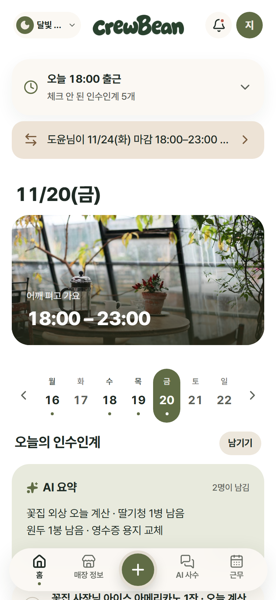
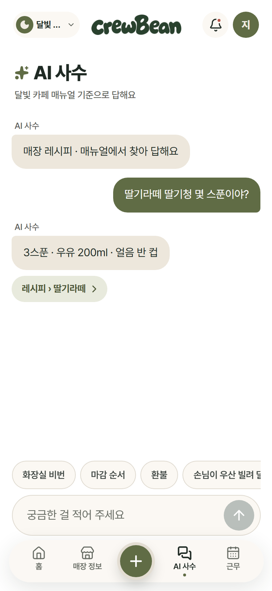
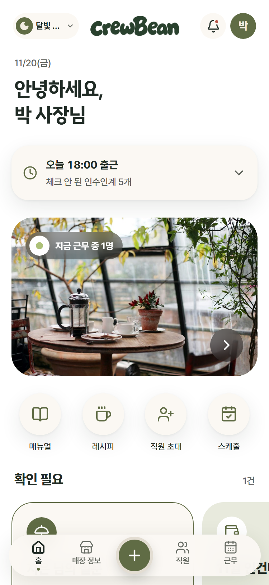

# ☕ crewBean — Frontend

> **개인 카페 신입 알바생의 든든한 선배, crewBean.**
> 앱 안의 **AI 사수**가 우리 매장 매뉴얼 · 레시피로 답하고, 모르는 건 지어내지 않고 사장님께 물어봐 주는 웹 앱입니다.

2026 AI 우왕톤 **13팀 F4**의 프론트엔드 저장소입니다. (모바일 웹 · PWA)

| 저장소   | 링크                                                                            |
| -------- | ------------------------------------------------------------------------------- |
| Frontend | 지금 보고 있는 저장소                                                           |
| Backend  | [WOOWANGTHON_TEAM_13_BE](https://github.com/woowangthon/WOOWANGTHON_TEAM_13_BE) |

<!-- 스크린샷: docs/screenshots/ 에 넣고 아래 주석을 풀어 주세요
<p align="center">
  
  
  
</p>
-->

---

## 🧭 한눈에 보기

개인 카페의 신입 알바생은 레시피 · 마감 순서 · 손님 응대가 헷갈려도 사장님께 계속 묻기 어렵고,
사장님은 같은 질문에 반복해서 답하느라 시간을 씁니다.

**AI 사수는 매장 매뉴얼을 근거로 바로 답하고, 근거가 없으면 사장님께 질문을 넘깁니다.**

```text
사장님                         알바생
───────                        ───────
매장 등록 · 초대코드 발급  ──▶  초대코드로 입장
레시피 · 매뉴얼 등록       ──▶  포스기처럼 레시피 보기 · 매뉴얼 찾기
                               AI 사수에게 질문 → 매뉴얼 출처와 함께 답변
"확인 필요" 질문에 답하기  ◀──  못 찾으면 [사장님께 물어보기]
인수인계 확인 · 체크       ◀──  인수인계 남기기 (AI가 항목별로 정리)
추천 스케줄 확정 · 급여    ──▶  근무 가능 시간 제출 · 내 근무표 · 예상 급여
```

---

## ✨ 주요 기능

### 🙋 알바생 화면 (`/staff`)

| 기능                     | 설명                                                                                                                                                                 |
| ------------------------ | -------------------------------------------------------------------------------------------------------------------------------------------------------------------- |
| **카카오 · 구글 로그인** | Supabase Auth, 처음 로그인하면 역할(사장님 / 알바생) 선택                                                                                                            |
| **초대코드 입장**        | 6칸 코드 입력 → "○○ 카페 · ○○ 사장님 · ○○ 님 자리" 확인 → 입장, 틀린 횟수 · 잠금 안내                                                                                |
| **⭐ AI 사수 채팅**      | 매장 매뉴얼 · 레시피를 근거로 답하고 **출처 카드** 표시, 근거가 없으면 _"찾지 못했어요. 제가 지어내지 않을게요"_ + **사장님께 물어보기** → 사장님 답변이 채팅에 도착 |
| **레시피**               | 포스기처럼 카테고리 탭 · 검색 · 메뉴 사진, 재료 · 양 표 · 만드는 순서                                                                                                |
| **매뉴얼**               | 와이파이 · 오픈 · 마감 등 매장 안내, 비밀번호 바로 복사                                                                                                              |
| **인수인계**             | 줄글로 쓰면 AI가 외상 · 재고 · 기타로 정리, 항목별 체크 · 태그 · 글자 수정                                                                                           |
| **근무**                 | 다음 달 근무 가능 시간 제출, 내 근무표(이번 주 시간 · 주휴수당 기준), 예상 급여(참고용)                                                                              |
| **n잡 매장 전환**        | 여러 매장에서 일하면 상단에서 매장 전환 (매장별 색)                                                                                                                  |
| **마이페이지**           | 이름 바꾸기 · 소속 매장 · 로그아웃 · 회원 탈퇴                                                                                                                       |

### 👔 사장님 화면 (`/owner`)

| 기능                     | 설명                                                                   |
| ------------------------ | ---------------------------------------------------------------------- |
| **매장 등록**            | 이름 · 주소 · 사업장 규모                                              |
| **직원 · 초대코드**      | 알바생 추가 → 초대코드 발급 · 복사 · 카톡 공유, 시급 설정 · 퇴사 처리  |
| **레시피 · 매뉴얼 관리** | 템플릿으로 작성 · 수정 · 삭제, 레시피 사진 · **사진 스캔으로 AI 초안** |
| **확인 필요**            | 알바생이 넘긴 질문을 모아 보고 답하기                                  |
| **인수인계**             | 주간 인수인계 · AI 요약 · 처리 체크                                    |
| **근무 · 급여**          | 가능 시간 제출 현황, 추천 스케줄 → 조정 → 확정, 직원별 급여(주별 근거) |

---

## 🛠 기술 스택

| 분류          | 사용 기술                                                       |
| ------------- | --------------------------------------------------------------- |
| Core          | React 19 · TypeScript · Vite                                    |
| 라우팅 · 상태 | React Router · TanStack Query(서버 데이터) · Zustand(화면 상태) |
| 스타일        | Tailwind CSS · shadcn/ui · lucide-react                         |
| 로그인        | Supabase Auth (Kakao · Google OAuth)                            |
| API           | `apiFetch`(Bearer 토큰) · orval(Swagger → API 함수 생성)        |
| 품질          | ESLint · Prettier · TypeScript strict                           |
| 배포          | Vercel · PWA (vite-plugin-pwa)                                  |

---

## 🧩 FE 설계 포인트

### 1. 화면은 훅만, 데이터는 한곳에서

화면은 `src/lib/api/`의 훅(`useRecipes`, `useAssistantChat`, `useHandoverNotes` …)만 부르고, 서버 호출 · 데이터 모양 맞추기는 훅 안에서 처리합니다. 응답 모양은 BE와 함께 정한 `docs/07_API_응답_제안.md`를 따릅니다.

### 2. 기능별 진짜 API / 가짜 서버 스위치

BE API가 기능별로 하나씩 열리는 동안에도 개발 · 시연이 멈추지 않도록, `.env` 한 줄로 기능마다 진짜 API와 가짜 서버(`src/api/mocks`)를 고를 수 있습니다.

```bash
VITE_REAL_API=                    # 비우면 모두 가짜 서버 (시연 데이터)
VITE_REAL_API=users,recipes       # 고른 기능만 진짜 API
VITE_REAL_API=all                 # 모두 진짜 API
```

### 3. 실패 · 빈 화면 · 느린 응답까지

- **실패**: 서버 연결 실패 · 로그인 만료(401)를 한곳에서 처리하고, 목록 자리에 "○○을 불러오지 못했어요 + 다시 시도"를 남깁니다.
- **빈 화면**: 새 매장처럼 데이터가 없을 때 다음 행동 버튼을 보여 줍니다.
- **느린 응답**: 목록 데이터로 상세 시트를 먼저 열고, 체크 · 제출은 누르는 즉시 반영합니다.
- **AI 실패**: AI 답변 · 정리가 안 될 때도 화면이 깨지지 않고 다시 시도 · 직접 정리를 제공합니다.

### 4. 모바일 웹을 앱처럼

주소창 색 · 상단 고정 흐림 · 뒤로 가기 시 스크롤 위치 유지 · 오프라인 안내 · 누를 때 반응 · 아이폰 입력 확대 방지 · 안드로이드 키보드 대응.

---

## 🚀 시작하기

```bash
npm install
cp .env.example .env   # 값은 팀 DM으로 공유받아 채웁니다
npm run dev            # http://localhost:5173 (로그인 때문에 5173 포트여야 해요)
```

### 둘러보기 모드 (로그인 · BE 없이)

`.env`에서 `VITE_SKIP_AUTH=true`, `VITE_REAL_API=`(비움) → 시연 데이터로 모든 화면을 볼 수 있어요.

### 진짜 BE 연결 모드

BE를 `localhost:8000`에서 켜고 `.env`를 아래처럼 맞춥니다.

| 변수                                                  | 뜻                                                 |
| ----------------------------------------------------- | -------------------------------------------------- |
| `VITE_API_URL`                                        | BE 주소 (`http://localhost:8000/api/v1`)           |
| `VITE_SUPABASE_URL` · `VITE_SUPABASE_PUBLISHABLE_KEY` | Supabase 로그인 (공개용 키만)                      |
| `VITE_KAKAO_JS_KEY`                                   | 카카오톡 공유                                      |
| `VITE_SKIP_AUTH`                                      | `true`면 로그인 없이 화면 보기 (개발용)            |
| `VITE_REAL_API`                                       | 진짜 API로 부를 기능 (`all` · 기능 이름 쉼표 구분) |

| 명령어           | 설명                                                   |
| ---------------- | ------------------------------------------------------ |
| `npm run dev`    | 개발 서버                                              |
| `npm run build`  | 타입 검사 + 배포용 빌드                                |
| `npm run lint`   | ESLint                                                 |
| `npm run format` | Prettier                                               |
| `npm run api`    | BE Swagger로 API 함수 자동 생성 (`src/api/generated/`) |

---

## 📁 프로젝트 구조

```text
src/
├── app/               # 라우터 · 로그인 가드 · 공통 처리(에러 · 오프라인 안내)
├── lib/
│   ├── api/           # 기능별 데이터 훅 + 진짜/가짜 스위치 (source.ts)
│   ├── auth.ts        # Supabase 로그인
│   └── apiClient.ts   # Bearer 토큰 · 에러 모양 통일
├── api/
│   ├── mocks/         # 가짜 서버 (staff · owner) — 시연 데이터
│   └── generated/     # orval 자동 생성 (직접 수정 X)
├── ui/                # 디자인 시스템 공용 부품 (Button · Card · BottomSheet …)
├── shared/            # 사장님 · 알바생이 같이 쓰는 부품 (레시피 · 매뉴얼 · 인수인계 · 매장)
└── pages/
    ├── auth/          # 로그인 · 로그인 처리 · 역할 선택
    ├── staff/         # 알바생 화면
    └── owner/         # 사장님 화면
docs/                  # 서비스 개요 · 우선순위 · 시나리오 · 화면/주소 · 로그인/API · 디자인 규칙 · API 응답 제안
```

---

## 👥 FE 팀원

| 이름                                                      | 담당                                | 한 일                                                                                                                                                                                                  |
| --------------------------------------------------------- | ----------------------------------- | ------------------------------------------------------------------------------------------------------------------------------------------------------------------------------------------------------ |
| **류민지** ([@ryu-min-ji](https://github.com/ryu-min-ji)) | 공통 뼈대 · 알바생 화면 · 공용 부품 | 프로젝트 세팅 · 로그인 · 초대코드 입장 · AI 사수 채팅(사장님께 물어보기) · 인수인계 · 레시피 · 매뉴얼 · 근무 · 급여, 데이터 훅 · 진짜/가짜 스위치 · 공통 에러 처리, BE 실제 API 연결, 모바일 UX 다듬기 |
| **최나현** ([@nahyun2](https://github.com/nahyun2))       | 디자인 시스템 · 사장님 화면         | 서비스 전체 디자인 · `src/ui` 부품 · 알바생 화면 디자인 구현, 사장님 화면(매장 · 직원 · 초대코드 · 레시피 · 매뉴얼 · 사진 스캔 · 확인 필요 · 근무 · 급여), 사장님 API 연결                             |

---

## 🤝 협업 방식

- **폴더 주인 제도**: 각자 폴더만 고치고, 남의 폴더는 import만 합니다. (`.github/CODEOWNERS`)
- **브랜치**: `main`(배포) ← `dev`(통합) ← `feat/…` · `fix/…` · `docs/…`
  - 내 폴더만 바꾼 PR은 올린 사람이 merge, 상대 폴더를 바꾼 PR은 상대 승인 후 merge, `main`은 승인 1명
- **작게 자주**: 기능 단위 챕터로 나눠 PR → 화면 확인 → merge
- **문서 같이 고치기**: 파일 · 화면 · 주소가 바뀌면 `docs/04`도 같은 PR에서
- **AI 페어 프로그래밍**: 규칙은 [`CLAUDE.md`](./CLAUDE.md), 맥락은 [`docs/`](./docs)에 두고 Claude Code와 함께 개발

### 커밋 규칙

```text
<type>: <변경 내용>
```

| Type       | 설명                              |
| ---------- | --------------------------------- |
| `feat`     | 새로운 기능                       |
| `fix`      | 버그 수정                         |
| `docs`     | 문서                              |
| `style`    | 동작에 영향 없는 화면 · 코드 모양 |
| `refactor` | 기능 변경 없는 구조 개선          |
| `test`     | 테스트                            |
| `chore`    | 설정 · 라이브러리                 |
| `perf`     | 성능                              |
| `build`    | 빌드                              |
