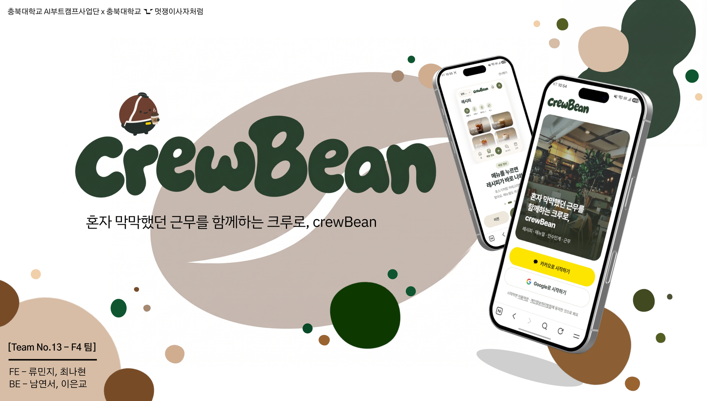

<div align="center">



<br />
<br />

개인 카페 신입 알바생에게 **우리 매장 매뉴얼 · 레시피로 답하고**,<br />
모르는 건 **지어내지 않고 사장님께 넘기는** AI 사수 웹 앱

<sub>2026 AI 우왕톤 · 13팀 F4 · 주제 "AI는 동료가 될 수 있는가" · 산업 현장(개인 카페)</sub>

<br />

[🌐 서비스 열기](https://woowangthon-team-13-fe.vercel.app) &nbsp;·&nbsp;
[🎬 시연 영상](https://www.youtube.com/watch?v=tNBlgXNmUDY) &nbsp;·&nbsp;
[⚙️ Backend 저장소](https://github.com/woowangthon/WOOWANGTHON_TEAM_13_BE)

</div>

---

## 한눈에 보기

|                             |                                                                                                    |
| --------------------------- | -------------------------------------------------------------------------------------------------- |
| **누구의 문제?**            | 바쁜 사장님께 계속 묻기 어려운 **개인 카페 신입 알바생**, 같은 질문에 반복해서 답하는 **사장님**   |
| **왜 일반 AI로는 안 되나?** | 우리 매장 레시피 · 규칙을 몰라 그럴듯하게 **틀린 답**을 줄 수 있어서                               |
| **crewBean은?**             | 매장에 등록된 매뉴얼 · 레시피에서만 답하고 **출처를 표시**, 근거가 없으면 **사장님께 질문을 넘김** |
| **사람이 하는 일**          | 사장님이 넘어온 질문에 답하고, 답변을 매뉴얼로 저장할지 결정                                       |

→ 자세히: [문제 · 해법 · AI의 역할](docs/problem-and-solution.md)

## 주요 기능

| 🙋 알바생                                               | 👔 사장님                                              |
| ------------------------------------------------------- | ------------------------------------------------------ |
| **AI 사수 채팅** — 출처 표시 · 모르면 사장님께 물어보기 | **확인 필요** — 넘어온 질문 답변 → 매뉴얼 AI 초안      |
| **레시피 · 매뉴얼** — 포스기처럼 카테고리 · 검색        | **레시피 · 매뉴얼 관리** — 사진 스캔으로 AI 초안       |
| **인수인계** — 줄글 → AI가 항목별 정리 · 체크           | **인수인계** — 하루 AI 요약 · 처리 체크                |
| **근무 · 예상 급여** — 공유 근무표 · 대타 요청          | **근무 · 급여** — 고정 근무표 · 대타 승인 · 급여(공제) |
| **초대코드 입장 · 여러 매장 전환 · 앱 알림**            | **매장 등록(사업자 확인) · 직원 초대 · 데스크톱 화면** |

→ 자세히: [주요 기능](docs/features.md)

## 기술 설계

```text
React · PWA (Vercel) ──Bearer 토큰──▶ FastAPI (Render) ──▶ PostgreSQL · Storage (Supabase)
      │                                     ├─▶ Google Gemini (답변 · 정리 · 사진 읽기)
      └─ Supabase Auth (카카오 · 구글)        ├─▶ 국세청 사업자 상태조회
                                            └─▶ Web Push (앱 알림)
```

| Core                         | 상태 · 데이터            | 스타일                      | 로그인 · 알림                  | 배포   |
| ---------------------------- | ------------------------ | --------------------------- | ------------------------------ | ------ |
| React 19 · TypeScript · Vite | TanStack Query · Zustand | Tailwind CSS v4 · shadcn/ui | Supabase Auth · Web Push (PWA) | Vercel |

→ 자세히: [기술 설계 · 직접 구현 vs 외부 기술 · 프로젝트 구조](docs/architecture.md) · [한계와 검증](docs/limitations.md)

## 실행 방법

**배포 사이트** — [woowangthon-team-13-fe.vercel.app](https://woowangthon-team-13-fe.vercel.app)에서 카카오 · 구글로 로그인 → 역할 선택 (휴대폰 권장 · 홈 화면에 추가하면 앱처럼 실행)

**로컬 (로그인 · BE 없이 둘러보기)**

```bash
npm install
cp .env.example .env    # VITE_SKIP_AUTH=true, VITE_REAL_API= (비움) → 샘플 데이터로 모든 화면
npm run dev             # http://localhost:5173
```

→ 자세히: [실행 방법 · 환경변수 · 명령어](docs/getting-started.md)

## FE 폴더 구조

```text
src/
├── app/               # 라우터 · 로그인 가드 · 쿼리 공통 설정(에러 · 재시도) · 오프라인 안내 · 앱 알림 동기화
├── lib/
│   ├── api/           # 기능별 데이터 훅 + 진짜/가짜 스위치 (source.ts)
│   ├── auth.ts        # Supabase 로그인 · 로그아웃 · 탈퇴
│   └── apiClient.ts   # Bearer 토큰 · 에러 모양 통일
├── api/
│   ├── mocks/         # 가짜 서버 (staff · owner) — 시연 데이터
│   └── generated/     # orval 자동 생성 (직접 수정 X)
├── ui/                # 디자인 시스템 공용 부품 (Button · Card · BottomSheet …)
├── shared/            # 사장님 · 알바생이 같이 쓰는 부품 (레시피 · 매뉴얼 · 인수인계 · 매장 · 사용법)
├── pages/
│   ├── auth/          # 로그인 · 로그인 처리 · 역할 선택
│   ├── staff/         # 알바생 화면
│   └── owner/         # 사장님 화면
└── sw.ts              # 서비스 워커 (오프라인 캐시 · 앱 알림)
docs/                  # 제출용 정리 · 개발 문서
```

## 문서

| 제출용 정리                                             | 개발하며 쓴 문서                                       |
| ------------------------------------------------------- | ------------------------------------------------------ |
| [문제 · 해법 · AI의 역할](docs/problem-and-solution.md) | [01 서비스 개요](docs/01_서비스_개요.md)               |
| [주요 기능](docs/features.md)                           | [03 사용자 시나리오](docs/03_사용자_시나리오.md)       |
| [기술 설계](docs/architecture.md)                       | [04 화면 · 파일 · 주소](docs/04_화면_파일_주소.md)     |
| [한계와 검증](docs/limitations.md)                      | [05 로그인 · API](docs/05_로그인_API.md)               |
| [실행 방법](docs/getting-started.md)                    | [07 API 응답 제안 (FE → BE)](docs/07_API_응답_제안.md) |
| [팀과 협업 방식](docs/team.md)                          | [08 디자인 규칙](docs/08_디자인_규칙.md)               |
| [사용한 오픈소스 · 데이터](docs/credits.md)             |                                                        |

## 팀 F4

|                    류민지                    |                 최나현                 |                 이은교                 |                  남연서                  |
| :------------------------------------------: | :------------------------------------: | :------------------------------------: | :--------------------------------------: |
| [@ryu-min-ji](https://github.com/ryu-min-ji) | [@nahyun2](https://github.com/nahyun2) | [@euungyo](https://github.com/euungyo) | [@yeontteo](https://github.com/yeontteo) |
|         FE · 알바생 화면 · 공통 뼈대         |       FE · 디자인 · 사장님 화면        |     BE · 인증 · 매장 · 근무 · 푸시     |    BE · AI · 레시피 · 인수인계 · 급여    |

<sub>AI 페어 프로그래밍(Claude Code)으로 개발하고, 모든 PR은 사람이 화면을 직접 테스트한 뒤 merge했어요. → [협업 방식](docs/team.md)</sub>
